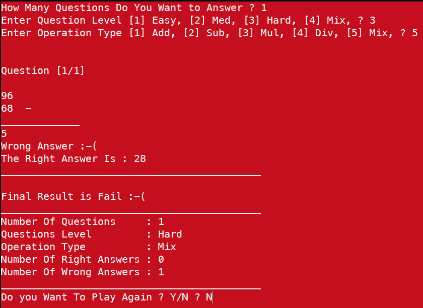
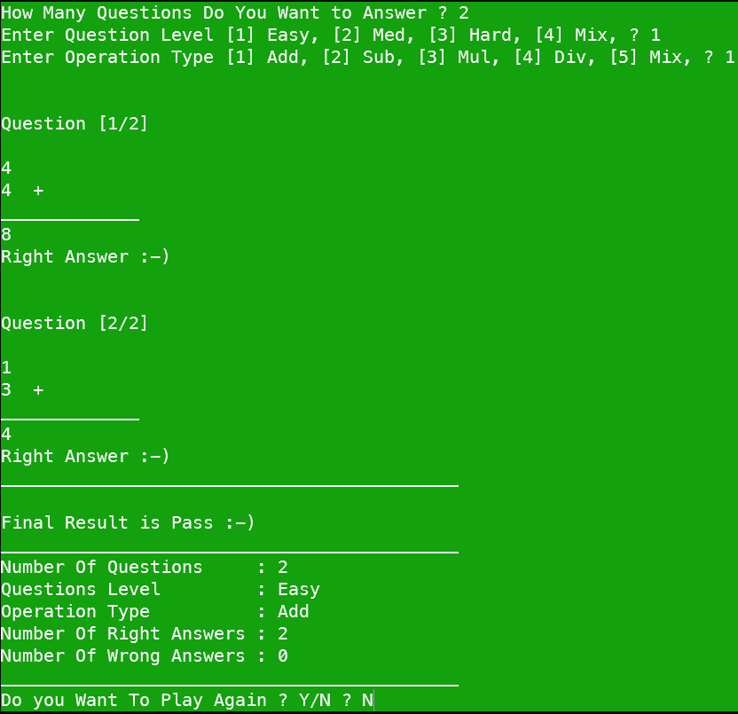

# 🧮 Math Game (C++)

A console-based interactive arithmetic quiz that challenges the player with randomized questions across multiple difficulty levels and operations, providing real-time feedback and a detailed final score report.

## 🎓 Training Source
This project was developed as part of the **ProgrammingAdvices** roadmap by Dr. Mohammed Abu-Hadhoud.
- **Course:** Algorithms & Problem-Solving — Level 2
- **Stage:** Foundational (pre-OOP)
- 🔗 [programmingadvices.com](https://programmingadvices.com/)

## 🎯 Project Objectives
- Practice **structured programming** in C++ before moving to OOP.
- Implement **user-driven configuration** for quiz parameters (number of questions, difficulty, operation type).
- Use **nested structs** to model complex state (a quiz containing multiple questions).
- Apply **pass-by-reference** to avoid copying large data structures.
- Build a complete game loop with replay functionality.

## ✨ Features
- Customizable quiz setup: choose the number of questions (1–10), difficulty level, and operation type.
- 4 difficulty levels (Easy, Medium, Hard, Mixed) with dynamic number ranges.
- 5 operation types (Add, Subtract, Multiply, Divide, Mixed).
- Automatic question generation with correct-answer computation.
- Real-time feedback with color-coded console UI (green for correct, red for wrong).
- Alert sound on incorrect answers.
- Pass/fail determination based on the ratio of correct to wrong answers.
- Detailed final results screen summarizing the session.
- Replay option to start a new quiz without restarting the program.

## 🧩 Key Components
| Component | Description |
|---|---|
| `PlayMathGame()` | Coordinates the full quiz flow (setup, questions, results) |
| `enQuestionLevel` | Enum for difficulty levels (Easy, Med, Hard, Mix) |
| `enOperationType` | Enum for arithmetic operations (Add, Sub, Mul, Div, Mix) |
| `stQuestionsList` | Struct holding a single question's data and result |
| `stQuizz` | Struct holding the full quiz session (array of questions + scores) |
| `GenerateQuestion()` | Creates a random question based on level and operation |
| `StartGame()` | Main game loop with replay support |

## 🖥️ Example Gameplay

*A session demonstrating incorrect answers, showing the red console feedback.*

*A successful session showcasing correct answers .*

## 🛠️ Tech Stack
- **Language:** C++
- **Paradigm:** Structured Programming
- **Libraries:** `<iostream>`, `<cstdlib>`, `<ctime>`

## ▶️ How to Run
### Using Visual Studio (Recommended)
1. Open the `c05-Math-Game.sln` file in Visual Studio.
2. Press `Ctrl + F5` (Run without debugging) or click the green **Play** button.
3. The quiz will launch in a console window.

## 🧠 What I Practiced At This Stage
This was an early project in my journey, built **before** I studied OOP. It helped me solidify:
- Modeling complex state using **nested structs** (`stQuizz` containing an array of `stQuestionsList`).
- Passing structs **by reference** to avoid expensive copies and allow direct modification.
- Building robust **input validation** loops to ensure user choices are within valid ranges.
- Difficulty-based randomization using enum-driven range selection.
- Designing a complete **game loop** with reset and replay functionality.
- Handling arithmetic operations and edge cases within a structured console application.

## 👤 Implementation
**Fatoun Al-Abdullah**
- 💼 [LinkedIn](https://www.linkedin.com/in/fatoun-al-abdullah-94b6991b4/)
- 🐙 [GitHub](https://github.com/Futooni)

This implementation is based on the instructor's reference solution from the ProgrammingAdvices roadmap. I studied it thoroughly to understand structured programming patterns before applying them in later projects.
## 📄 License
This project is open source and free to use for educational purposes.